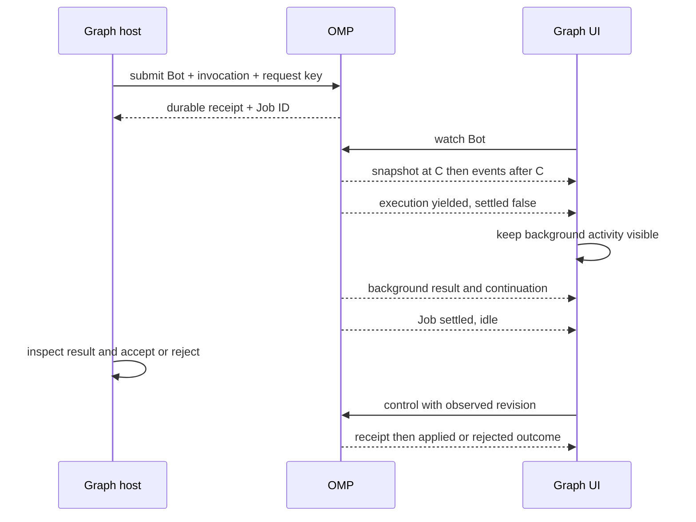
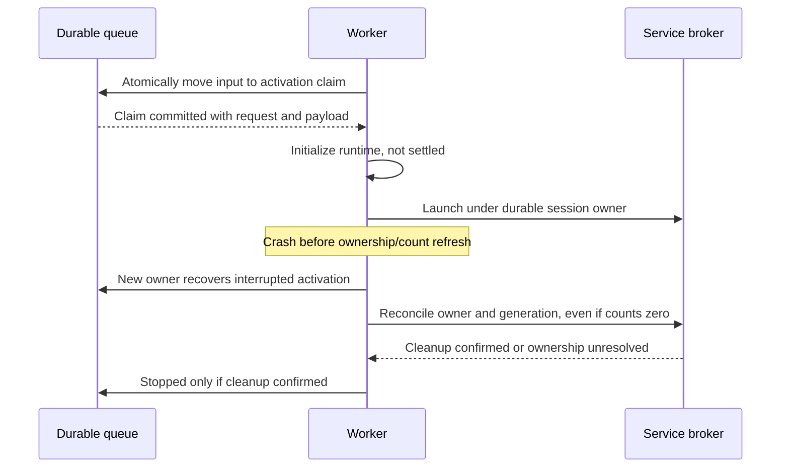

# Bot execution and Graph observability specification

Status: OMP CLI/runtime hardening is implemented. `guileen/wherdr` now has an authenticated local Bot workspace preview and safe conversation SVG fences, verified against actual source CLI and a deterministic local provider. Its explicit sample Graph is not a production Graph host. Full `omp.graph.v1` streaming/history/remote/multi-user conformance, Mac mini deployment and real-device/stress acceptance remain open. OMP runtime implementation stays under `packages/coding-agent/src/bots/`, with minimal shared hooks; external UI/adapter code stays in wherdr.

The active change is [OpenSpec: harden-bot-graph-observation](../openspec/changes/harden-bot-graph-observation/proposal.md), including M1–M6, historical regressions and external Graph/PWA contracts. Sections 1–5 below own CLI wire v1; [shared contracts](../openspec/changes/harden-bot-graph-observation/contracts.md) own the implemented additive CLI fields/guards and the still-proposed `omp.graph.v1` browser protocol. Strict specification validation alone is not implementation or visual acceptance.

## 1. Boundary and ownership

OMP exposes named, restricted execution nodes through CLI commands. External programs own Graph topology, scheduling, retries, dependency satisfaction and business acceptance. OMP does not add an HTTP API, Graph engine or built-in Graph editor.

The selected wherdr adapter has two explicit data paths: Herdr sockets for terminal/pane state, and guarded OMP CLI for Bot/Job snapshots, durable events and controls. Current Herdr plugin actions/logs are not a generic resumable provider protocol; the source audit and isolated runtime probe are recorded in the active OpenSpec design. Terminal disconnect/exit never proves detached Bot completion or dispatches its cancellation.

| Object | Owner / identity | Contract |
|---|---|---|
| Bot | OMP; immutable `bot_id`, unique `bot_name` within `profile_id` | Long-lived capability definition; Graph references its fixed name. Recreating a deleted name produces a different ID. |
| Job | OMP; `job_id` | One assignment, isolated conversation, progress and artifacts; multiple exchanges allowed. Many Jobs can use one Bot. |
| Execution | OMP; `execution_id` | One admitted foreground activation, including its tool loop; observable identity, not another user-managed object. Automatic continuations get new IDs. |
| Request | Caller initiates; OMP assigns `request_id` | Submission, message or control operation; receipt and effect are distinct. |
| Graph placement | External orchestrator | Optional correlation supplied at submission, immutable for the Job; not an instruction to schedule anything. |
| Graph edge / acceptance | External orchestrator | Never inferred from tool calls, timestamps, text or OMP `idle` state. |

Bot and Job context do not inherit coding-agent prompts, project rules, tools, Skills, MCP, extensions or memory. Only explicitly configured capabilities load; model credentials are reused. Necessary tool instructions accompany their tools. No auxiliary LLM calls for observation, naming, progress summaries or Graph metadata.

Bot defaults to its creation directory, stored absolutely. A Job may override `--cwd`. Both configuration revision and effective prompt/skill contents are pinned for a Job; resume cannot silently expand capabilities. Filesystem isolation is not implied by context isolation or `cwd`: external sandboxes/worktrees own that boundary. Jobs execute serially per Bot by default; separate Bots can run concurrently.

## 2. Command contract

```bash
omp bot create reviewer --system-prompt ./reviewer.md --tools read,grep --skills-dir ./skills/review --cwd ./project
omp bot list --json
omp bot reviewer submit "Review PR123 cancellation" --request-key graph42-review-1 --context ./placement.json --json
omp bot reviewer status --json
omp bot reviewer status j123 --json
omp bot reviewer watch --json
omp bot reviewer watch j123 --since '<cursor>' --json
omp bot reviewer messages j123 --json
omp bot reviewer send j123 "Check timeout cleanup" --json
omp bot reviewer send j123 "Do not modify files" --steer --json
omp bot reviewer interrupt j123 --json
omp bot reviewer resume j123 --json
omp bot reviewer compact j123 --mode qaonly --json
omp bot reviewer set-model j123 provider/model --json
omp bot reviewer stop j123 --json
```

`create` stores a definition without inference. `submit` takes positional text or stdin, requires nonempty input and rejects both supplied together. Other commands follow `omp bot <BotName> <subcommand>`. `status`/`watch` without a Job aggregate that Bot; mutating commands require a Job, except explicit `stop --all`. Default `send` queues a subsequent exchange; `--steer` enters at a safe current-execution boundary. No implicit latest-Job selection.

All commands support `--json`; watch is JSONL, other commands produce one JSON object. Diagnostics use stderr. Submit/send/control return after durable admission, not after model completion. Read-only commands wait only for the requested local read; `watch` stays attached. Disconnecting a viewer does not stop work.

Put the global profile before the command: `omp --profile graph bot reviewer status --json`. Bot names `create` and `list` are reserved. With no explicit model, creation stores an unresolved preference without credential checks or inference; execution resolves the profile's default model. Creation/list responses expose identity and revision, not raw prompts or capability paths.

Use a separate worktree or sandbox directory per concurrent assignment when filesystem isolation is needed. A Bot's captured working directory does not change when commands are later called elsewhere.

Every named operation accepts `--expect-bot-id ID`, checked together with lookup/admission/read; a recreated same-name Bot returns `unknown_bot`. Watches pin the validated immutable identity. `inspect REF --job JOB_ID` additionally enforces reference and page-token ownership, returning `permission_denied` for another Job. External bridges must supply these guards; they do not replace browser-user authorization.

### Submission correlation

`--context` accepts a JSON file with this exact shape; absent context is `null`. Unknown keys are rejected. All identifiers are nonempty opaque strings; `attempt` is an integer >= 1. Graph correlation identifiers and request keys are published verbatim: callers MUST use non-sensitive values, never credentials, private content or complete paths. They are not redacted previews.

```json
{
  "graph_id": "release-review",
  "graph_run_id": "gr42",
  "node_id": "review",
  "invocation_id": "review-item7",
  "attempt": 1,
  "trace_id": "trace42",
  "upstream": [
    {"edge_id": "draft-to-review", "job_id": "j122", "artifact_id": "a9"}
  ]
}
```

`graph_id`, `graph_run_id`, `node_id`, `invocation_id`, `attempt` are required together. `trace_id` is nullable/optional. `upstream` defaults to `[]`; each element requires `edge_id`, with nullable/optional `job_id` and `artifact_id`. References describe caller-asserted provenance, not verified availability or permission. An invocation distinguishes loop/map items at the same node; orchestrator retries keep invocation ID and increment attempt. Provider retries do not increment it. One Bot can occupy several nodes.

`--request-key` is optional on submit/send/control, scoped by profile and Bot identity. Within retained Job history, same key plus same canonical operation and payload returns the original receipt; different payload returns `idempotency_conflict`. The key remains reserved if content is pruned: return `request_expired`, never silently execute again. Idempotency of admission does not imply exactly-once external side effects.

## 3. Read model: snapshots before logs

UI clients need a current-state snapshot, then ordered changes. They must not reconstruct current state by interpreting assistant prose or consuming an entire transcript. `status` returns the same projection as watch bootstrap. Successful projection response: `schema_version: 1`, `kind: snapshot`, `profile_id`, `bot`, `jobs`, `cursor`, `next_page_token` (nullable). Empty `jobs: []` is valid, not an error.

All timestamps are RFC3339 UTC; durations are milliseconds. IDs/cursors are strings, never numeric JavaScript counters. Fields below are required unless marked optional; nullable means unknown/not applicable, not zero.

### Bot projection

| Field | Type / meaning |
|---|---|
| `bot_id`, `bot_name`, `config_revision` | Strings; immutable identity, address, current definition revision |
| `worker` | `{state: online\|offline\|unknown, last_seen_at: string|null}`; process connectivity, not Job outcome |
| `counts` | Object keyed by every Job state below, counts over the whole Bot, not just a page or selected Job; an explicit Graph-run snapshot scope narrows the counts |
| `jobs_total` | Integer including historical Jobs in the Bot/count scope; `jobs[]` may separately select one Job |

Do not collapse an entire Bot to one green/red state when its Jobs disagree. Bot cards show active/queued/attention counts; selecting a Graph run narrows those counts explicitly.

The public `worker.last_seen_at` is the latest published worker observation. Changing it MUST atomically append `bot.changed`; snapshots MUST expose that published value. Internal lease heartbeats MAY remain unpublished and MUST NOT silently alter the public projection. Viewer heartbeat freshness and worker liveness are separate signals.

### Job projection

| Field | Type / meaning |
|---|---|
| `job_id`, `bot_id`, `config_revision` | Strings; resolve ownership and frozen effective configuration |
| `revision` | Decimal string, monotonic per Job; stale control guard |
| `goal_preview`, `goal_ref`, `cwd` | Redacted bounded string, full input reference or null, effective directory display value |
| `graph_context` | Submission correlation object or null |
| `state` | `queued`, `running`, `waiting_input`, `idle`, `paused`, `stopped`, `interrupted`, `failed` |
| `phase` | `queued`, `model`, `tool`, `background`, `input`, `compacting`, `retry_wait`, `cancelling`, `none` |
| `settled` | Boolean; no live/admitted execution, runnable queued input, owned background work or pending delivery can advance this Job |
| `execution_id` | String or null; current foreground execution |
| `input_requests` | Current typed question summaries with protected `prompt_ref`, `open\|reply_queued\|completion_queued` status and correlated completion; exact fields in the shared contract |
| `ownership` | `{state: none\|active\|uncertain, activation_ref: string|null}`; guarded activation evidence, including initialization and crash recovery |
| `pending_input_count`, `pending_background_count`, `pending_delivery_count` | Nonnegative integers; suspended inputs remain counted but cannot auto-run |
| `activity` | `{kind, label, span_id}` or null; kind `model\|tool\|background\|control`; bounded runtime-derived label, nullable span ID |
| `wait` | `{kind, message, request_id, retry_at}` or null; kind `input\|approval\|capacity\|provider\|retry`; nullable request/retry time |
| `progress` | `{source, completed, total, unit}` or null; source `todo\|tool`, integer counts with `0 <= completed <= total`, nonempty unit |
| `model` | `{current: string|null, pending: string|null}`; current is null until the model is resolved; pending means accepted but not applied |
| `context` | `{used_tokens: integer|null, limit_tokens: integer|null}`; estimate refreshed with the projection, whose `updated_at` identifies freshness |
| `usage` | `{input_tokens, output_tokens, cache_read_tokens, cache_write_tokens, cost_usd, completeness, measured_at}`; counts/cost nullable, cost decimal string, completeness `complete\|partial\|unknown`, timestamp nullable |
| `created_at`, `updated_at`, `last_activity_at` | UTC timestamps; heartbeat alone does not refresh activity |
| `elapsed_ms`, `active_ms` | Integers sampled at `updated_at`; elapsed since creation and active foreground duration through that instant, excluding queue/user wait; not sum of overlapping tool spans |
| `output_ref` | Latest finalized assistant answer reference or null; never a declaration of business success |
| `artifact_ids` | String array of published artifact identities |
| `error` | `{code: string, message: string, retryable: boolean}` or null; redacted, structured runtime failure |
| `controls` | Array of `{action, enabled, reason}`; action `send\|steer\|interrupt\|resume\|compact\|set-model\|stop`; disabled action has a nonempty reason |

Progress is measured units, not a model-generated percentage. A changing Todo denominator can move a ratio backwards; UI labels it “tasks”, not “overall completion”. Unknown tokens/cost render `—`. Usage is cumulative per Job, includes failed/provider-retried calls when reported, and does not double-count repeated events. Parent work cannot also include another displayed Job's usage. A cached-token field is not added to input totals unless that provider's normalized accounting explicitly requires it.

Timing values MUST remain identical for the same Job revision across snapshots and events. A newer revision MUST include the current foreground interval, not reset `active_ms` to completed-execution time. UI MAY derive a separate live wall-elapsed display from `created_at`, without modifying authoritative projection values or treating heartbeat time as Job activity.

`running/phase=background` covers model yield with pending asynchronous work. `idle` requires `settled=true`; it means ready for another exchange, not accepted by the business workflow. `failed` requires execution cleanup to have finished. `interrupted` may have `settled=false` when ownership or external effects remain uncertain. `waiting_input` describes a runtime-issued question/approval, not an assistant sentence guessed to be a question.

Current question summaries survive event pruning. Reply admission reserves the question; only runtime consumption or cancellation removes it. Automatic timeout/dialog completion also reserves, then reacquires foreground capacity before tool code resumes. A pending compact cannot block this necessary continuation.

`ownership.state=none` may retain a reference to the last closed activation (`stage=closed`, `recovery=not_required`). Reference presence is historical evidence, not proof of current work; consumers use `state`.

## 4. Event, replay and detail contract

### Envelope

Every durable event contains: `schema_version: 1`, `kind: event`, `profile_id`, `bot_id`, nullable `job_id`, nullable `execution_id`, nullable `request_id`, `event_id`, `cursor`, `occurred_at`, `type`, nullable `cause_event_id`, and `data`. Cursor is `{journal_id: string, seq: decimal-string}`; sequence increases within the Bot journal across process restarts. There is no cross-Bot total order. Dependencies use Graph identities and causal references, never wall-clock sorting alone.

| Type | `data` payload / consumer use |
|---|---|
| `bot.changed` | `{bot}` full Bot projection, including connectivity/counts |
| `job.changed` | `{job}` full Job projection; authoritative revision replacement, not ambiguous partial merges |
| `request.accepted` | `{command, key}`; key nullable |
| `request.finished` | `{command, outcome, effective_at, error}`; outcome `applied\|rejected\|cancelled`, nullable effective time/error; applied describes command semantics, not business success |
| `execution.started` | `{trigger}` where trigger is `submit\|send\|resume\|background` |
| `execution.yielded` | `{outcome, output_ref, settled}`; outcome `returned\|cancelled\|error`; does not assert Job completion |
| `job.settled` | `{revision}`; emitted once per active-to-settled transition; associated execution/requests have already published their outcomes |
| `span.started` / `span.finished` | `{span_id, parent_span_id, kind, label, started_at, ended_at, outcome, detail_ref}`; nullable parent/end/outcome/detail, kind `model\|tool\|background\|compaction`, outcome `ok\|error\|cancelled\|unknown` |
| `input.required` | `{input_request_id, kind, prompt_ref}`; kind `text\|approval`; send uses `--reply-to` to resolve that exact question |
| `artifact.published` | `{artifact_id, name, media_type, size_bytes, content_ref, producer_span_id}`; size/producer nullable; reference is permission checked |
| `output.updated` | `{message_id, revision, preview, content_ref, final}`; bounded preview, full cumulative body via reference; no durable token-by-token duplication |

Bot/job summary projection is sufficient without spans; spans are lazy detail, fetched via `omp bot reviewer events j123 --after <cursor> --limit <n> --json`. Replying to a missing/resolved question returns `input_request_closed`, not an unrelated follow-up. `messages` and `events` are paginated with opaque `next_page_token`; reference resolution uses `omp bot reviewer inspect <ref> --json`, with `{ref, availability, media_type, content, next_page_token}`. `availability` is `available|redacted|expired|missing`; content is null unless available. Binary content returns metadata, not inline arbitrary bytes. Profile permissions apply to reads, watches and commands.

The authorization boundary is the local OS user/profile, not an individual viewer or Job. Reference lookup checks Bot ownership within that profile; a reference is not a separate viewer-level permission grant. An external multi-user Graph host MUST enforce its own read/control authorization before forwarding profile access or detail contents.

Single-question replies accept text. For a multi-question form, send a JSON object keyed by every question ID; multi-select values are string arrays, other values are strings: `omp bot reviewer send j123 '{"target":"B","flags":["X","Y"]}' --reply-to INPUT_ID --json`. Invalid form replies do not close the question. Approval replies use the offered allow/deny choices. An ordinary follow-up cannot bypass a pending question.

For a multi-select question, an explicitly supplied empty array is the supported “select none” answer. Required means the field must be present, not that at least one option must be selected.

Job-scoped replay/watch includes `bot.changed` connectivity and whole-Bot counts alongside the selected Job's events; unrelated Job details remain excluded. Whole-Bot counts in the bootstrap and subsequent events therefore use the same scope. Additive `runtime.notice` events carry `{level,message}` for bounded runtime notifications.

Stop/interrupt closes runtime questions and removes their queued targeted replies, emitting additive `input.cancelled` events with `{input_request_id,reason:"question_closed"}` and the affected request ID. Pending reply admissions become cancelled; ordinary follow-ups remain frozen. An already-applied admission is not retroactively relabeled.

### Gap-free bootstrap

1. `watch` without `--since` emits a consistent snapshot at watermark C, then events strictly after C. Large snapshots use `snapshot.begin`, numbered `snapshot.page`, `snapshot.end`, all with the same `snapshot_id` and cursor; UI commits only after end. No silent page truncation.
2. `watch --since C` replays after C, then follows. Delivery may repeat across reconnect; consumers deduplicate by `event_id` and reject older projection revisions. Job filters may skip sequence numbers legitimately.
3. Invalid/foreign cursor returns `invalid_cursor`. Pruned history returns `cursor_expired` with `reset_required: true`; never silently jump to live. Caller restarts without cursor to obtain a fresh snapshot.
4. Heartbeat frames are ephemeral `{schema_version:1, kind:heartbeat, cursor, observed_at}` at least every 5 seconds while connected. After 15 seconds without frames, UI labels connection stale, preserves the last state and disables mutating controls until refreshed. Stale does not mean failed.
5. Slow consumers may be disconnected with `slow_consumer`, last emitted cursor and `reset_required: false`; committed lifecycle events are not dropped. Pre-publication output/usage updates may be coalesced, but final answers, errors and control outcomes must remain recoverable.

Routine progress may be coalesced to at most four projection updates per second per Job; transitions, input requirements and control outcomes bypass coalescing. UI batches rendering independently. Observation does not add model messages, keep a Job awake or allocate one model call per viewer.

## 5. Control and failure semantics

Control receipt fields: `schema_version`, `kind: receipt`, `bot_id`, `job_id` (null for Bot-wide control), `request_id`, `accepted: true`, `cursor`. Failures use `kind: error`, `accepted: false`, nullable `request_id`, and `{code, message, retryable, details}` under `error`; CLI exits nonzero. Post-admission failures arrive via `request.finished` and remain queryable through `omp bot reviewer request <request_id> --json`.

Request lookup returns `{schema_version: 1, kind: request, receipt, outcome, effective_at, error}`: outcome is `pending|applied|rejected|cancelled`, with nullable effective time/error. It does not wait. Unknown IDs return `unknown_request`. For input commands, applied means admission to the input queue; execution events carry the later result.

Mutating Job controls accept `--if-revision`. A mismatch rejects atomically with `revision_conflict` and `details.current_revision`; UI refreshes rather than resending a potentially different action. Capability/ownership is rechecked on application; a disabled button is not enforcement.

| Operation | When applied / required visible behavior |
|---|---|
| submit/send | Input durably queued; execution outcome follows separately. Busy send does not interrupt. |
| interrupt | Cancellation has unwound; queued input is frozen; `paused`. During cleanup show `phase=cancelling`, never prematurely paused. |
| stop | Owned execution/background processes are stopped; `stopped`. External side effects are not rolled back. Late events cannot resume execution. |
| resume | Exclusive execution ownership obtained and work admitted. Crash recovery never blindly repeats an uncertain side-effecting tool. |
| compact | Remains pending until no foreground activation, runtime question, owned background work or pending delivery prevents a safe boundary; runs before ordinary follow-up input. Targeted replies needed to reach that boundary MUST bypass pending maintenance. qaonly uses canonical task/plan/background state, no LLM; observation journal and artifact IDs survive. |
| set-model | Next model request will use the model; pending/current are separate. Reject incompatible context rather than silently deleting content. |

Stop/interrupt supersede pending compact/model-switch operations, which receive cancelled outcomes; queued input remains stored but frozen. `stop --all` returns one parent receipt and per-Job child outcomes: partial failure must be visible. Background cleanup failures produce a rejected control result and an attention/error state, not false stopped success.

Unknown in-memory background ownership after a worker crash remains visible and blocks automatic scheduling; `cleanup_failed` is returned rather than pretending the work was stopped. Persisted named bash services can be recovered by session owner and stopped by generation. Resume never replays an uncertain tool: it admits only stored subsequent input, or leaves the recovered Job idle for new input. A failed launcher cannot overwrite a request already applied by a live worker.

Queue removal MUST atomically transfer the request identity and input payload to a durable activation claim, before asynchronous initialization or provider/tool dispatch. Initialization is admitted work and prevents settlement. Recovery MUST reconcile claims even if initialization never completed: input remains queued if no claim committed; a lost claimed activation is explicitly interrupted, with its input retained for inspection and no blind replay of uncertain effects.

After worker loss, zero sampled background/delivery counts are not proof of absent ownership. Before successful stop, resume or settlement, reconcile external services by durable session owner and service generation regardless of sampled counts. Ownership must remain discoverable across the launch-to-observation crash window; unresolved ownership keeps the Job interrupted/unsettled and returns `cleanup_failed`, never false stopped success.

Required error codes: `invalid_input`, `unknown_bot`, `unknown_job`, `unknown_request`, `permission_denied`, `idempotency_conflict`, `request_expired`, `revision_conflict`, `input_request_closed`, `invalid_state`, `incompatible_model`, `invalid_cursor`, `cursor_expired`, `slow_consumer`, `unsupported_version`, `cleanup_failed`, `internal_error`. Errors never masquerade as empty snapshots, zero usage or successful completion. Version 1 consumers ignore additive fields and unknown event types, but render unknown state values as unsupported and disable controls. Breaking changes require a new schema version, rejected rather than misinterpreted.

Implemented additions include current-question/ownership projections, normalized protected question details, snapshot/bootstrap `capabilities`, `--expect-bot-id` and `inspect --job`. Consumers must check capabilities before depending on these semantics; an old source's missing metadata does not mean an empty question list.

### Database upgrade and uncertain ownership

CLI wire stays v1; the profile-private Bot database is schema 2. Schema-1 migration refuses while a legacy worker/process lock is live, saves a standalone consistent `bots.sqlite.schema1-*.backup` with private permissions, preserves IDs/keys/historical references, and blocks already-open legacy writers after cutover. Active legacy work becomes interrupted/uncertain, not automatically replayable. Stop legacy workers before upgrading; rollback requires stopped/reconciled services and an explicit offline restore, not running an old binary against schema 2.

Service launch intents and session-owner epochs are durable before broker dispatch. Stop fences the owner and reconciles exact generations even when published counts are zero. Missing/corrupt ledgers or absent launch evidence remain `cleanup_failed`; empty enumeration is not cleanup proof. Detached native startup remains pending, and final cleanup is published only after its ledger commit.

### Wire examples

Admission (success):

```json
{"schema_version":1,"kind":"receipt","bot_id":"b1","job_id":"j123","request_id":"q456","accepted":true,"cursor":{"journal_id":"bj1","seq":"120"}}
```

Stale UI control (failure):

```json
{"schema_version":1,"kind":"error","request_id":null,"accepted":false,"error":{"code":"revision_conflict","message":"Refresh Job state before applying this control","retryable":false,"details":{"current_revision":"19"}}}
```

Model yielded but background work remains (boundary):

```json
{"schema_version":1,"kind":"event","profile_id":"p1","bot_id":"b1","job_id":"j123","execution_id":"x8","request_id":"q456","event_id":"e121","cursor":{"journal_id":"bj1","seq":"121"},"occurred_at":"2026-11-04T10:00:00Z","type":"execution.yielded","cause_event_id":null,"data":{"outcome":"returned","output_ref":"o3","settled":false}}
```

Empty Bot snapshot (valid zero, not failure):

```json
{"schema_version":1,"kind":"snapshot","profile_id":"p1","capabilities":["bot.questions.v1","bot.ownership.v1","bot.identity-guard.v1","bot.scoped-refs.v1"],"bot":{"bot_id":"b1","bot_name":"reviewer","config_revision":"v1","worker":{"state":"offline","last_seen_at":null},"counts":{"queued":0,"running":0,"waiting_input":0,"idle":0,"paused":0,"stopped":0,"interrupted":0,"failed":0},"jobs_total":0},"jobs":[],"cursor":{"journal_id":"bj1","seq":"0"},"next_page_token":null}
```

Nonempty Job projection (the `job` payload of `job.changed`, and an element of snapshot `jobs`):

```json
{
  "job_id": "j123",
  "bot_id": "b1",
  "config_revision": "v1",
  "revision": "19",
  "goal_preview": "Review PR123 cancellation",
  "goal_ref": "input1",
  "cwd": "~/project",
  "graph_context": {
    "graph_id": "release-review",
    "graph_run_id": "gr42",
    "node_id": "review",
    "invocation_id": "review-item7",
    "attempt": 1,
    "trace_id": "trace42",
    "upstream": []
  },
  "state": "running",
  "phase": "background",
  "settled": false,
  "execution_id": null,
  "input_requests": [],
  "ownership": {"state": "active", "activation_ref": "activation1"},
  "pending_input_count": 0,
  "pending_background_count": 1,
  "pending_delivery_count": 0,
  "activity": {"kind": "background", "label": "Checking cancellation cleanup", "span_id": "sp4"},
  "wait": null,
  "progress": {"source": "todo", "completed": 2, "total": 3, "unit": "tasks"},
  "model": {"current": "provider/model", "pending": null},
  "context": {"used_tokens": null, "limit_tokens": null},
  "usage": {
    "input_tokens": 1200, "output_tokens": 320,
    "cache_read_tokens": null, "cache_write_tokens": null,
    "cost_usd": null, "completeness": "partial",
    "measured_at": "2026-11-04T10:00:00Z"
  },
  "created_at": "2026-11-04T09:59:00Z",
  "updated_at": "2026-11-04T10:00:00Z",
  "last_activity_at": "2026-11-04T10:00:00Z",
  "elapsed_ms": 60000,
  "active_ms": 40000,
  "output_ref": "o3",
  "artifact_ids": [],
  "error": null,
  "controls": [
    {"action": "send", "enabled": true, "reason": null},
    {"action": "steer", "enabled": false, "reason": "No foreground execution"},
    {"action": "interrupt", "enabled": true, "reason": null},
    {"action": "resume", "enabled": false, "reason": "Job is already active"},
    {"action": "compact", "enabled": true, "reason": null},
    {"action": "set-model", "enabled": true, "reason": null},
    {"action": "stop", "enabled": true, "reason": null}
  ]
}
```

## 6. Graph UI consumption and visual contract

The canonical external-UI requirements now live in [graph-operations-ui](../openspec/changes/harden-bot-graph-observation/specs/graph-operations-ui/spec.md); host/bridge behavior lives in [graph-observation-bridge](../openspec/changes/harden-bot-graph-observation/specs/graph-observation-bridge/spec.md). These are consuming-product contracts, not a commitment to add a Graph engine, HTTP server or editor to OMP.

### Information architecture

The operations cockpit uses attention-first navigation, stable responsibility nodes, shared graph/list/timeline selection and an exact invocation/attempt/Job inspector. Host records—not assistant prose or temporal proximity—supply immutable Run definitions, acceptance, dependency evidence and confirmed transfers. Missing topology uses a roster/timeline.

### Interaction and presentation

The capability spec owns desktop/mobile layout, semantic zoom, typed inline questions versus follow-ups, request ambiguity, read-only history, PWA suspension, accessibility and evidence-based motion. A confirmed live transfer may animate once; replay, worker heartbeats and artifact publication alone cannot fabricate delivery. The design document supplies architecture, state tables, user flows and Mind-Test acceptance.

Existing herdr terminal notifications/launch are not evidence of a herdr/wherdr PWA Graph adapter. External authorization and source-scoped readiness are required before controls become available. Actual browser/device acceptance remains unperformed.

## 7. Mind-Test and acceptance

The scenarios below define runtime and external-UI acceptance separately. Runtime verification uses real SDK/tool fixtures and actual CLI subprocesses against a deterministic local provider, without remote LLM calls. UI acceptance requires a consuming application's rendered interaction and screenshots at desktop and 390 px; no Graph UI is built or visually verified inside OMP.



| ID | WHEN | THEN / evidence required |
|---|---|---|
| O1 | One Bot handles two Graph runs, and two loop items share a node | UI separates Jobs by run/invocation/attempt; no history, progress or control target crosses jobs. |
| O2 | Model yields while a background tool is pending | Answer is readable; node remains working/background until settled; Graph does not receive false business completion. |
| O3 | UI attaches during state changes, disconnects and reconnects | Snapshot plus replay yields the same latest projection as uninterrupted observation; duplicates do not duplicate answers or usage. |
| O4 | Cursor is pruned, foreign, or journal was replaced | Explicit reset/error; stale view remains labeled until fresh bootstrap, never silent event loss. |
| O5 | Two clients control the same Job | Stale revision is rejected; only one execution owner; UI refreshes and does not hide a race. |
| O6 | Stop races with tool result and queued send | Cancelling remains visible until cleanup; late result is preserved without waking the stopped Job; request has one terminal outcome. |
| O7 | Worker dies after a side effect but before recording completion | Interrupted/uncertain appears, not success or automatic replay; recovery requires an explicit action. |
| O8 | Submit receipt is lost and caller resubmits the same key | Original Job returned; different input with that key conflicts; graph attempt remains caller-owned. |
| O9 | qaonly runs during an observed Job | Observation history/cursors/artifacts survive; task state preserved; no summarizer call; pending compact clearly visible. |
| O10 | Model switch is queued during generation or rejected for incompatibility | Current and pending differ until the boundary; rejection is visible and old model remains effective. |
| O11 | Usage is partial, zero, or unavailable; Todo count changes | Partial badge, numeric zero and unknown dash remain distinct; no invented cost, ETA or overall percentage. |
| O12 | Fan-out produces many spans and a slow viewer | Canvas node count follows host topology, not tool calls; bounded previews/detail paging; viewer reconnects without losing lifecycle events. |
| O13 | Input/approval is requested while another Job waits in the Bot queue | Waiting reason and targeted reply are visible; waiting Job releases execution capacity; reply to stale question is rejected. |
| O14 | Summary contains hostile markup or recognized secrets, or a detail request crosses authorization scope | Content remains inert; preview redaction and reasoning exclusion hold; protected refs enforce their declared scope. Public IDs remain caller-supplied non-sensitive metadata, not a universal DLP guarantee (M6). |
| O15 | Operator inspects an old attempt while live events arrive | Viewport/selection/scroll remain; history controls disabled; live return refreshes revision. |
| O16 | Same Bot serves another node or its name is deleted/recreated | Host binds correct immutable identity and placement; old and new Bots never merge by display name alone. |
| O17 | Desktop/390 px, keyboard-only and reduced-motion interactions | Full observe/reply/control flow remains usable; state is understandable without color or animation. |
| O18 | Bot-wide stop partially fails, or a watcher loses heartbeat | Per-Job control outcomes / stale connectivity are shown; neither becomes a false global stopped/failed state. |

### 2026-11-04 adversarial Mind-Test

Historical audit, before this implementation: M1–M5 were open defects; M6 narrowed an overbroad privacy promise. The rows retain original evidence/source positions, not the current implementation status. Initial probes made no production changes or remote model calls. See the later implementation evidence for exercised fixes.

| ID / priority | Historical counterexample/evidence | Closure criterion |
|---|---|---|
| M1 / P1 — admission handoff | **Runtime reproduced:** SIGKILL after dequeue, during runtime initialization; restart leaves request `applied`, Job `queued`, input count 0, execution ID null, error null, and no activation. `worker.ts:163–165,389–404`; `store.ts:959–967`. Static companion trace: initialization refresh can emit `idle/job.settled` before the first execution starts. | Inject crashes before/after the durable activation claim and during initialization. Each accepted input remains queued or inspectably claimed/interrupted; never lost or transiently settled while admitted work remains. Covers O7/O8. |
| M2 / P1 — unobserved service ownership | **Static counterexample; process repro pending:** service starts, worker dies before ownership/count refresh, persisted counts remain zero. Stop skips recovery discovery and can report stopped while a broker service survives. `worker.ts:250–258,625–626,655–692`; `agent-runtime.ts:396–397`. | Keep a second broker client alive; kill the worker after service launch but before projection refresh. Stop must confirm owner/generation cleanup or reject with `cleanup_failed`; resume cannot bypass reconciliation. Covers O6/O7. |
| M3 / P2 — maintenance/input dependency | **Static counterexample; runtime repro pending:** compact during a runtime question reaches runtime validation and is rejected, rather than kept pending. Merely deferring it would block the targeted reply needed to clear the question. `worker.ts:150–162,327–345`; `agent-runtime.ts:575–584`. | With an open question or pending delivery, compact remains pending. A targeted answer can advance the current exchange; maintenance then runs at a safe boundary before ordinary follow-ups. Stop cancels pending maintenance. Covers O9/O13. |
| M4 / P2 — duration regression | **Runtime reproduced:** snapshot revision 4 reports `active_ms=43`; the next `job.changed`, revision 5, reports 0 during the same execution. Read-time sampling and event accumulator disagree (`store.ts:454–458,903–924`). | Snapshot and event values agree at the same revision/time; newer revisions never lose accumulated foreground duration. Queue/user wait remains excluded. Covers O3/O11. |
| M5 / P2 — unpublished worker freshness | **Runtime reproduced:** lease heartbeat changes snapshot `last_seen_at` while cursor is unchanged and replay has zero events (`store.ts:1362–1371`). | A changed public worker sample is paired atomically with a replayable `bot.changed`; otherwise snapshots retain the last published value. Internal lease and viewer heartbeat remain distinct. Covers O3/O18. |
| M6 / boundary clarification | **Runtime confirmed:** synthetic private paths in `trace_id` and request key reach snapshots/admission events unchanged (`store.ts:468–477,1080–1088`). Opaque metadata cannot simultaneously be verbatim and universally redacted. | Callers use non-sensitive identifiers; privacy acceptance separately checks redacted preview fields, raw reasoning exclusion, profile access and host-side viewer authorization. This is not a universal DLP guarantee. Covers O14. |

Shared-state crash model; SQLite owns input/activation transitions, the worker lease/file lock owns dispatch, and the broker owns external service lifetime. The database and broker do not share a transaction: uncertainty blocks scheduling/settlement rather than being converted into success.

| Crash boundary | Durable state required | Recovery / permitted transition |
|---|---|---|
| Before activation claim | Input still queued | Another exclusive owner may claim it; no dispatch has occurred. |
| After claim, before/during initialization | Request/payload linked to activation | Lost owner → interrupted, no silent replay or disappearance. |
| After service launch, before count publication | Durable session ownership sufficient to discover the service | Reconcile by owner/generation even when sampled counts are zero. |
| Ownership unresolved | Interrupted, unsettled | No automatic scheduling; stop/resume cannot claim success. |
| Cleanup confirmed | Frozen ordinary inputs, no owned execution/work | Stop → stopped/settled; only explicit resume unfreezes input. |



### Existing integration anchors

- [RPC yield versus settled](rpc.md#yield-vs-settled): preserve the distinction between answer availability and no remaining asynchronous work. Current RPC event/message IDs are not promised durable Graph identities; this contract requires that additional layer.
- [Agent Hub](agent-hub.md#roster-and-inspector): reuse roster/inspector, measured usage and missing-data conventions; it concerns session subagents rather than named Bots.
- [Compaction](compaction.md): conversation compaction must remain separate from the observation journal and Job ownership.

Runtime evidence: `packages/coding-agent/test/bot-store.test.ts`, `bot-agent-runtime.test.ts`, `bot-worker.test.ts`, `bot-cli.test.ts`, and `bot-observation.test.ts`. The real CLI smoke exercised durable idempotency, a real read tool, no ambient rules/default tools, independent Job contexts, model switching, replay and qaonly with zero additional model requests. `omp --smoke-test` includes the hosted Bot worker's no-inference control probe. These are runtime/CLI checks, not visual acceptance of O1/O12/O14–O18 in an external Graph client.

Historical verification, 2026-11-04, before the adversarial Mind-Test above: 90 Bot contract tests and 98 existing routing/profile/worker/SDK/completion regressions passed; coding-agent type checks and touched-source lint/format checks passed. Actual CLI subprocesses used a deterministic local provider (7 model requests across 4 Jobs); qaonly and the exercised crash-owned named-service cleanup scenario each added zero model requests. The hosted worker's no-inference probe passed. These results do not cover M1–M5's newly identified boundaries or imply complete acceptance. External Graph UI visual/accessibility acceptance remains the consuming application's responsibility.

### 2026-11-04 implementation verification

OMP-side M1–M5 are closed by the implemented claims/fences, continuation gates and revisioned samples. The final affected suite passed **455 tests across 36 files**, including 70 launch tests. Actual subprocess crashes cover all input-handoff boundaries and a real zero-count service launch with a surviving broker client; cleanup adds no model request. A failing-before/passing-after watch regression also covers a consumer stalled at a page boundary and replay of its committed outcome.

Actual source CLI verification used two isolated Jobs and four deterministic local model requests: real read, per-Job model switch, unchanged second-Job default, identity/scoped-reference denials, qaonly with zero additional requests, confirmed stop and closed activation inspection. Package types, touched-file lint and the dedicated no-inference Bot worker probe passed. Complete commands and remaining acceptance gates are in [tasks.md](../openspec/changes/harden-bot-graph-observation/tasks.md#implementation-verification--2026-11-04).

The user-authorized wherdr checkout now implements the section-8 local workspace preview and SVG fix, with real built-server/CLI/browser evidence recorded in [tasks.md](../openspec/changes/harden-bot-graph-observation/tasks.md#8-requested-workspace-preview-and-svg-correction-2026-11-05). Existing terminal/Board integration remains separate. Production Graph facts, full replay/history/authorization scope, remote sources, Mac mini deployment, physical-device behavior and the stress fixture are not claimed complete. No installed user service was modified.
