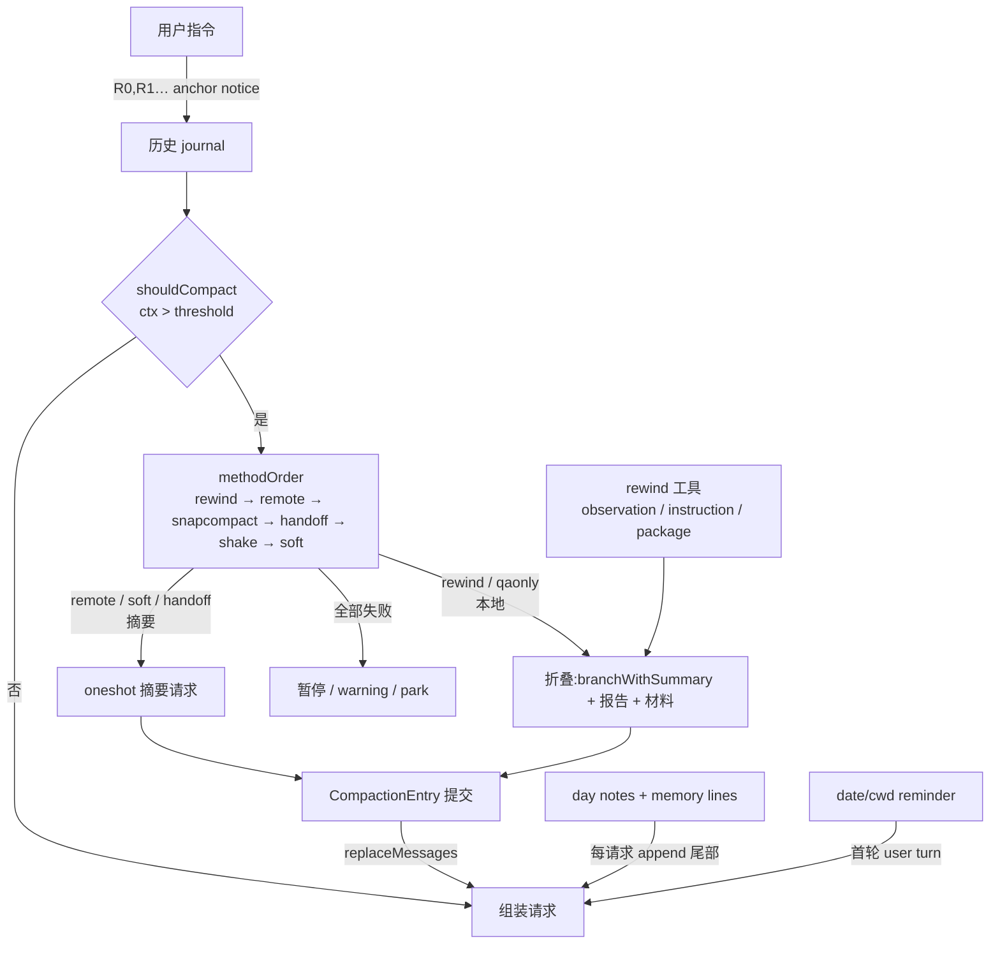

# Context Rewrite 综述（omp coding-agent）

范围：把"上下文重写"视为一个系统 —— 谁决定切、切哪、留下什么、以何代价重建前缀。
证据锚点一律 `path:line`（相对 `packages/coding-agent/src`，除注明）。`[推断]` 表示未经实测。

## 0. 一句话结论

omp 把重写拆成两层：**本地折叠（不花钱、保字节前缀）优先，模型摘要（花钱、换紧凑）兜底**；
二者共用一条阈值管线和一个提交守卫，而"什么是这一段工作的价值"由主 agent 自己在循环里写成报告，
而不是由外部摘要请求猜。四条注入链（rewind / compaction / handoff / memory）共享前缀不变量，
但在**证据选择**、**报告预算**、**缓存边界**上各有一套规则，尚未统一。

## 1. 四层结构

**层级判据**：折叠改的是"条目集合"（entry 层），压缩改的是"历史语义"（message 层），
记忆注入改的是"请求尾部"（request 层），anchor 改的是"切点可用性"（元数据层）。
四者都只动上下文，不回滚文件或外部动作（`prompts/tools/rewind.md:45`）。

## 2. 机制对照

| 维度 | rewind（工具/`/compact rewind`） | compaction（自动管线） | handoff / relay | memory 注入 |
|---|---|---|---|---|
| 触发 | agent 自行判断；日报 250 steps 提示一次 | 阈值 / overflow / length / idle | `/handoff`、`/compact relay`、自动阈值 | 每次请求 |
| 切点 | observation：调用前一条；instruction：notice 条目；package：checkpoint 条目 | `findCutPoint(keepRecentTokens)` | 同 compaction | 不切，只追加 |
| 产出 | 主 agent 报告（≤4096 tokens）+ retain/keep 材料 | 摘要文本（`min(0.8·reserve,16384)`） | handoff 文档（无 maxTokens） | `<system-notice>` 块 |
| 证据保留 | `retain` 行快照 / `keep` 精确子串 / `demote` 降级 | 滚动 summary + 尾部保留 | 文档内 `<files>` 累积 | lines 20/日、day notes 4 条 |
| 花钱 | 主循环内，不额外请求 | 摘要方法花钱，本地方法不花钱 | 一次 oneshot | 0 |
| 缓存 | 前缀逐字节保留，命中是估计 | 重写历史 → 关 provider session | promptCacheKey 镜像本轮 | 尾部 append，前缀不动 |

## 3. 关键参数（默认值）

| 参数 | 值 | 锚点 |
|---|---|---|
| reserve | `max(15% window, reserveTokens ?? 16384)` | `../../agent/src/compaction/compaction.ts:328-329` |
| 摘要输出上限 | `min(0.8·reserve, 16384)` | `../../agent/src/compaction/compaction.ts:919` |
| keepRecentTokens | 20000，再受 `0.8·trigger − reserveFloor` 约束 | `../../agent/src/compaction/compaction.ts:230,1546-1550` |
| 恢复带 | 提交后 headroom ≤ `0.8·threshold` | `../../agent/src/compaction/compaction.ts:207` |
| 方法顺序 | rewind, remote, snapcompact, handoff, shake, soft | `session/compaction-methods.ts:59-66` |
| retain 行数 / 选择上限 | 2000 行；retain/keep/demote ≤32，release/active ≤128 | `session/search-rewind.ts:232,281-286,475` |
| 折叠报告 | ≤4096 tokens（含 blocked reason）；day note 2000 chars | `session/agent-session.ts:8895,8933`; `session/context-memory.ts:25` |
| 节奏 | 日报 250 settled results；QA fold gate 12；记忆提醒 40k tokens | `session/instruction-anchor.ts:25,32`; `session/context-memory.ts:45` |
| memory line | 200 软提示 / 400 硬上限，20 条/日，16 起提示合并 | `session/context-memory.ts:129-135` |

## 4. 不变量

1. **折叠不改副作用**：只改上下文；文件、外部动作、todo 权威史不受影响。
2. **切点可复用前缀**：切点之前条目逐字节保留，`reusablePrefixTokens` 是估计不是保证（`tools/checkpoint.ts:98-103,396-401`）。
3. **fence 提交**：`appendEntriesAtomically` + generation/leaf/abort 三重守卫，失败不提交、不改内存（`session/agent-session.ts:9256-9274`）。
4. **fail-closed 校验**：stale boundary、批未 settled、跨 reset/compaction、快照 tag 歧义 → 拒绝而非错切（`session/search-rewind.ts:312-356`）。
5. **方法不可用则前进**：跳过而非报错；全失败才提示；本地-only 配置宁可暂停也不暗自付费摘要（`session/session-maintenance.ts:5925-5986,6040-6143`）。
6. **证据跨折叠存活**：active materials 经 compaction 仍注入，上限 128 条（`session/search-rewind.ts:108-226`）。

## 5. 张力与坏味道

### 5.1 已核实的文档/代码冲突
- `prompts/tools/rewind.md:33` 称指令点折叠"no net savings rejects"，实际 `allowNoSavings=true` 且仍写 day note（`session/agent-session.ts:8903-8905,14109-14114`）。
- `docs/context-memory.md` 描述记忆块位于对话之前，实现追加为**最末 user 消息**（`session/agent-session.ts:4873`，已核实）。选择尾部是为保住前缀，但要求严格 user/assistant 交替的 provider 会看到畸形序列。
- `#applyInstructionRewind` 注释称切点会移除 notice，实际 `branchWithSummary(resolved.entryId)` 保留（`session/agent-session.ts:13997-14000 vs 14053`）。

### 5.2 成本与正确性
- **receipt 保留完整 `details`**：退休工具的 receipt 携带结构化 details 与 async handle，净收益只按消息 token 估计，可能收缩后被再放大（`session/search-rewind.ts:459-468`）。
- **handoff 输出无预算**，输入无选择规则：整段 `agent.state.messages` 直接入请求，`toolChoice:none` + 基础 system prompt（`session/session-handoff.ts:128-177`）；`length` 即判失败，无降级到 soft。
- **摘要成本先于折叠**：默认 order 虽把 rewind 放第一，但 rewind 无 checkpoint 时以 blocker 前进，实际链路仍落到付费方法（`session/session-maintenance.ts:5980-5986`）。

### 5.3 结构重复
- 三套"结构化续作摘要"prompt（handoff-document / relay-compaction / compaction-summary）章节名互不一致，`relay` 复用了 handoff 的包裹层却声明不同章节，属语义错配 `[推断]`（`../../agent/src/compaction/messages.ts:122-124,252-255`）。
- `graph/rewind.ts:5`、`graph/handoff.ts:35` 与会话级同名不同物（scheduler 回边重放 / 边证据投影），检索噪声。
- 观察折叠对全分支做 3 次 plan/tokenize（工具内 2 次 + apply 1 次），大 journal 下 O(n)×3（`tools/checkpoint.ts:245,277`；`session/agent-session.ts:9165-9167`）。

### 5.4 记忆层
- 记忆块每次渲染全量 `getEntries()` 扫描（lines/dayStats/commands 各一遍），长会话 O(n) 多趟（`session/agent-session.ts:4759-4796`）。
- lines/day notes 不过 `reset_boundary` 过滤，`/clear` 后旧事实仍注入；被 rewind 丢弃分支上写的 line 仍计入当日 20 条预算。
- 会话记忆由 `checkpoint.enabled` 与 rewind 工具可见性间接门控，无独立开关（`tools/remember.ts:37-39`）；`docs/context-memory.md` §15 自认未决。

## 6. 演化方向（按收益/成本排序）

1. **统一"证据选择"契约**：把 search materials 的 retain/keep/demote 提升为所有 compaction 方法共享的唯一入口，handoff 也按其挑选输入，替代"整段历史"。
2. **给 handoff 加输出预算与结构校验**：`maxTokens` 对齐 `MAX_SUMMARY_TOKENS`，`length` 降级到 soft 而非失败。
3. **合并三套摘要 prompt 的章节模型**（Goal / Decisions / State / Evidence / Next），relay 只做收窄不作新体例。
4. **记忆块独立 token 分类**：`context-view.ts` 只把块算进普通消息，预算可视化失真；独立分类后才能验证"尾部注入"的成本假设。
5. **折叠前置度量**：在执行 rewind 前复用已算出的 plan 结果，避免工具内与 apply 各跑一遍计划。

## 7. 未验证项

- 尾部 `<user>` 记忆块在 Anthropic prefill / 严格交替 provider 上的实际失败率 `[推断：未实测]`。
- 投机摘要与真实 pass 的双计费规模 `[推断]`。
- `snapcompact` 位图归档在多模态 413 上的净收益 `[推断]`。
