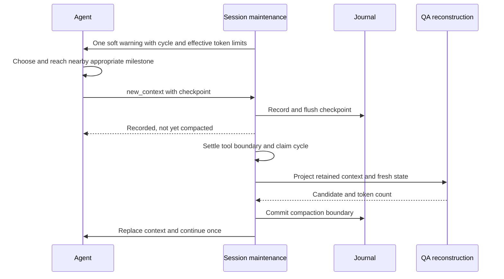

# Design

## Context

See [proposal.md](proposal.md) for scope and [behavior requirements](specs/milestone-qa-compaction/spec.md) for acceptance. This document owns the implemented internal contracts; [tasks.md](tasks.md) records exercised acceptance evidence and repository-wide verification limits.

### Evidence at planning time (2026-11-04)

| Observed source | Consequence |
|---|---|
| `src/session/context-settings.ts`: auto-compaction, mid-turn maintenance, and auto-continue default on | The missing feature is cooperative automatic QA rollover, not automatic compaction generally. |
| `src/session/compaction-methods.ts`: remote, snapcompact, handoff, shake, soft; no qaonly | Extend the existing method selection, not a second compaction policy. |
| `src/session/qa-compaction.ts`: user requests and terminal text answers retained from journal; todos/runtime state captured | Tool-loop commentary and findings disappear unless explicitly checkpointed. Q&A itself keeps growing. |
| `src/session/session-context.ts`: QA reconstructs retained entries and operational state | A tool-based checkpoint must be retained explicitly; merely returning it in a tool result is insufficient. |
| `src/session/session-maintenance.ts`: pre-prompt, mid-run, post-turn triggers; speculation; shared commit and recovery checks | One owner must arbitrate warning, speculation, checkpoint, and commit across all boundaries. |
| `src/session/agent-session.ts#scheduleCompactionContinuation`: queued input wins; terminal answers normally suppress continuation | A checkpoint needs explicit disposition; do not weaken terminal-answer protection globally. |
| `src/tools/context-notes.ts`: experimental `new_context({})` is a turn-local rollover signal | Reuse that tool name and lifecycle boundary, with a separate QA payload and mode guard. |

Paths above are relative to `packages/coding-agent/`. Threshold calculation is in `packages/agent/src/compaction/compaction.ts`. A direct Bun smoke invocation of the current implementation returned default limits 170,000/200,000 and 850,000/1,000,000; the automatic method parser discarded `qaonly`; QA retained fixture ids `u,f` and omitted tool-bearing id `t`. This proves those existing functions only, not the proposed flow.

## Goals / Non-goals

**Goals:** safe progress preservation, low-interruption autonomous milestone choice, a strict ordinary-work stop with reserved explicit reporting, no separate summary-model request on the successful QA path, one continuation owner, and compatibility with current user control and async delivery.

**Non-goals:** global defaults migration, adaptive cost scheduling, forced task completion, killing jobs, a new UI panel, a second context backend, or exactly-once remote side effects across process crashes.

## Product boundary and user flow

The operator opts in through existing Context settings (`compaction.methodOrder`). The QA-first work policy uses a fixed 120,000-token soft warning and 200,000-token ordinary-work stop, bounded by actual model capacity; existing threshold settings continue to serve other maintenance strategies and are not mutated. The agent chooses the appropriate nearby milestone after the warning; the operator does not need to type “continue.” Existing permissions remain in force. macOS, Linux, and Windows share session behavior; TUI/RPC/SDK consumers observe the existing lifecycle surfaces rather than implementing their own policy.

User documentation draft:

- Choose `qaonly` first in Compaction Method Order. Include `soft` later only if paid summary fallback is acceptable. Selecting only `qaonly` means pause rather than an implicit paid fallback.
- The QA-first warning/stop are 120K/200K input-context tokens when the model has sufficient room. Small models clamp earlier and reserve space for reporting. This is a work policy, not a measured optimal cost budget or a global threshold/default change.
- At the soft warning, the agent chooses a nearby useful milestone without a request-count deadline. At the ordinary-work stop, only a bounded structured report is admitted before QA or a safe fallback/pause. Successful rollover removes tool history from the prompt, keeps Q&A and actionable state, and resumes unfinished work.
- Escape/abort remains a stop. Completed work or a user-approval blocker does not become an endless continuation. Disabling auto-continue leaves the compacted task paused until normal input/delivery resumes it.
- A “QA cannot reclaim enough context” pause means retained Q&A, fixed instructions, or pending input dominates. Choose an allowed summary method, reduce fixed context, or explicitly start a new conversation. The durable journal remains available.
- There is no new service/fee. Ordinary provider calls still cost money; QA's local transformation is not a promise of a free rollover.



## Decisions

### 1. Budget semantics: cost target separate from model capacity

Keep the QA work policy separate from general configured compaction thresholds and model-name policies. For this QA policy:

- Safe report-input limit `P = min(promptBudgetTokens(window, settings), window - 8192)`. Preserve the model's normal safe input/output reserve, with an 8,192-token minimum reporting reserve even when configured reserve is zero, then 4,096 additional input tokens before the report limit. Effective ordinary-work stop `H = min(200000, P - 4096)` and warning `W = min(120000, floor(0.9 * H))`, in input-context tokens. The 90% clamp is a small-capacity guard, not the nominal warning policy.
- Recovery `R = floor(0.8 * W)`, hence 96,000 with the unclamped warning. Recovery is relative to the warning, not the hard stop or general configured trigger: a 160K retained candidate would immediately warn again and is not recovered. The same R applies to configured fallback methods and their fixed-context, shake, snapcompact and rescue guards while QA-first policy owns the cycle; choosing a fallback does not relax continuation safety.
- Cooperative mode requires usable actual capacity and distinct positive `R < W < H`; otherwise preserve ordinary safe maintenance/fallback instead of inventing model capacity.
- Warn once at `context >= W`. Below H the agent chooses its nearest appropriate checkpoint autonomously; there is no request-count quota, including for provider retries.
- At `context >= H`, stop ordinary work at the next settled synchronous-tool boundary. Admit only one bounded report-only attempt with `new_context` forced as the sole tool; report generation is not permission to execute ordinary tools or resume the old loop.
- The report request uses an 8,192-token output cap only when the catalog/transport supports preserving it and required thinking settings permit that cap. Otherwise retain the normal provider-native output behavior and safe input/output reserve; lack of a supported output-limit parameter is not itself a reason to deny reporting. Safety still enforces one actual report attempt, forced sole-tool admission, and the 4,096-token checkpoint-content cap. Do not add model-id exceptions or send unsupported transport parameters.
- If the report request cannot fit actual capacity, do not dispatch it. If the bounded report attempt fails or returns an invalid/missing checkpoint, do not restore ordinary work or retry reporting indefinitely: preserve raw history and use only later configured fallback methods or pause.
- Count pending input, completed tool results, fixed system/tool context, warning/report prompts and the checkpoint payload. Reuse provider-usage/local-estimate reconciliation and tokenizer caches; do not double-count system tokens already included in billed occupancy. After rewriting, use the rebuilt estimate until fresh provider usage arrives, not stale pre-compaction billing.
- Neither the nominal 200K stop nor reporting overrides the actual model window/output reserve. Unknown/unusable window size disables automatic QA policy rather than guessing.

The soft warning applies only when QA is the first usable method under the current ordered selection. If QA becomes selected at or above H, enter the reserved reporting boundary immediately rather than manufacturing an ordinary cooperative window. Do not launch speculative summarization while QA owns the selected cycle. Cancel an older speculative result on takeover; do not commit it over a QA checkpoint.

### 2. One lifecycle owner, no abort-to-checkpoint shortcut

`SessionMaintenance` owns a small QA cycle, separate from ordinary task/todo completion. It is called by the existing pre-prompt, mid-run, and post-turn boundaries. Respect `compaction.enabled`, current mid-turn eligibility (including existing subagent policy), and experimental-mode precedence.

| Field | Meaning / owner |
|---|---|
| `cycleId: string` | Opaque identity, unique for one session generation and compaction epoch; maintenance creates it. |
| `generation: number`, `boundaryId: string` | Captured session generation and latest reset/compaction boundary; invalidate stale actions. |
| `phase` | Warning/draining, bounded report-only, ready/compacting, or blocked lifecycle state; absence means normal. |
| `checkpointEntryId?: string` | Durable accepted checkpoint, absent until flush succeeds. |
| `H`, `W`, `R`, report capacity | Effective cycle watermarks and reserved safe reporting budget; revalidate on configuration/model changes before dispatch. No ordinary-work request counter exists. |

Only one cycle/commit may own maintenance at a time. Use existing compaction controllers and journal persistence barriers, not an additional mutex/scheduler. Revalidate generation, boundary, selection, and cancellation after every await that precedes mutation. No distributed lock or CAP choice is introduced: the local session journal is authoritative and existing async managers own their jobs.

| Current state + event | Transition / observable action |
|---|---|
| Normal, eligible active work reaches W | Queue warning once; `warning-pending`. |
| Warning dispatched | Drain toward the agent-chosen nearby milestone without a request quota. |
| Draining, settled tool work below H | Permit next ordinary request. |
| Draining, accepted checkpoint | `ready`; prevent ordinary loop dispatch before maintenance. |
| Ready, checkpoint + all tool records durable | `compacting`; fresh state projection. |
| Candidate <= R and commit succeeds | Clear cycle; rebuild/rebase; disposition-aware continuation. |
| H reached without checkpoint | Admit only the bounded report attempt if it safely fits; otherwise configured fallback or blocked. |
| QA candidate > R / method error | No-progress fallback, or blocked; no QA retry in this cycle. |
| Natural terminal answer | No invented continuation; retain answer and clear warning. QA may run as ordinary maintenance. |
| User abort/reset/session switch/manual compaction | Invalidate cycle; existing operation owns subsequent behavior. |
| Model/settings change | Revalidate before dispatch; cancel QA if no longer selected; if new capacity is exceeded, report safely or recover/pause now. |

A small safe milestone means saved edits or a bounded observation plus a truthful incomplete-work record, not “all tests must pass.” The soft warning lets the agent choose that milestone; more than three requests may be appropriate. A failed check is valid checkpoint evidence. In-flight synchronous tools settle under their existing timeout/abort semantics; do not terminate writes to manufacture the boundary. Async jobs are not synchronous blockers.

The `new_context` acknowledgement must park the current loop at its next settled boundary; do not both continue that loop and schedule a second loop. `continue` gets one owner-selected continuation; `complete`/`blocked` suppress ordinary loop continuation as well as synthetic nudges. User-input and existing async delivery scheduling remain independent and take priority.

The implementation uses `AgentTurnEndContext.stop` to park before the engine dequeues steering, follow-up input or asides. QA resumption opts into `Agent.continue(..., { queuedInputFirst: true })` when queued input owns the next run; independent idle job delivery clears the parked maintenance state. `StreamOptions.beforeProviderRequest` / `Agent.setBeforeProviderRequest` remain generic actual-transport admission gates, including retries, without charging discovery/authentication/prewarming. QA uses existing request tool-choice/admission mechanisms for the hard report boundary, not an ordinary-work request allowance. Structured admission denial stops only the provider request, not the user's session controller.

### 3. Shared checkpoint contract

Extend the existing `new_context` tool; do not introduce another checkpoint tool (the repo already has unrelated checkpoint/rewind operations). In QA mode it is available only while automatic QA is configured/eligible, and valid only for an issued current cycle. Experimental notes mode keeps `new_context({})` and its existing implementation; it rejects the QA variant rather than silently ignoring its data. QA mode rejects `{}`. Tool schema/gating and descriptions must agree across TUI, SDK, RPC, and subagent tool construction.

QA presents one closed checkpoint object with a disposition enum and optional `nextAction`, using `strict: false`; runtime validation enforces the conditional requirement/forbidden-field rules below. Per-field descriptions are static Markdown prompts. Historical live Codex probes with a nested strict union chose `complete` despite describing unfinished verification; the simplified schema plus explicit whole-task disposition guidance passed subsequent old-policy probes. Those observations concern schema guidance only and do not validate the superseding 120K/200K policy or the required `6-luna` live route.

#### Model -> tool -> maintenance

Input: `{ checkpoint: QaCheckpointInput }` in QA mode.

| Field | Type / required | Contract |
|---|---|---|
| `cycleId` | string / yes | Identifier supplied by the warning; not a tool-call id. |
| `summary` | nonempty string / yes | Saved changes, decisions, evidence locations/results, unverified claims, unfinished work, and blockers; free text, no required boilerplate headings. |
| `disposition` | `continue` \| `complete` \| `blocked` / yes | Resume intent, distinct from todo status. |
| `nextAction` | nonempty string / for continue | Concrete next operation; omitted for complete/blocked. A blocker belongs in summary. |

Summary plus nextAction is capped at 4,096 tokens under the active tokenizer, and must fit current safe request/context limits. Reject oversize; never silently truncate evidence. No time field is model-supplied. The journal owns timestamps and identity. Reject mixed-tool responses before executing this request; other tool calls follow their ordinary semantics and no QA boundary is claimed.

Success tool details: `{ requested: true, checkpoint: { cycleId, entryId, status: "accepted" | "already-accepted" } }`. This confirms journal persistence only. Identical same-cycle duplicates return the same entry; different content returns conflict. Accepted checkpoint data remains historical evidence, never higher priority than newer user instructions or live canonical state.

Failure tool details: `{ code, cycleId? }`, returned through the normal tool-error envelope with no mutation. Codes: `QA_NOT_ACTIVE` (wrong mode/no cycle), `QA_STALE_CYCLE` (wrong session/epoch), `QA_INVALID_CHECKPOINT` (fields, bound, or mixed response), `QA_CHECKPOINT_CONFLICT` (same cycle, different payload), `QA_PERSIST_FAILED` (journal failure). Invalid requests cannot extend the bounded hard-report attempt; below H they do not impose a new request quota. No free-form text matching controls transitions.

Examples (payloads, not model prompts):

```json
{"checkpoint":{"cycleId":"qa:42:7","summary":"Parser saved in src/parser.ts. Empty-input smoke passed; integration not run. Retry handling remains unchanged.","disposition":"continue","nextAction":"Run the parser integration scenario, then inspect its result."}}
```

```json
{"requested":true,"checkpoint":{"cycleId":"qa:42:7","entryId":"entry-19","status":"accepted"}}
```

```json
{"code":"QA_STALE_CYCLE","cycleId":"qa:41:6"}
```

```json
{"checkpoint":{"cycleId":"qa:42:7","summary":"Saved local edits; deployment needs user approval. No deployment attempted.","disposition":"blocked"}}
```

#### Journal -> context reconstruction

Store a session custom entry `qa-rollover-checkpoint` with `{ version: 1, cycleId, summary, disposition, nextAction? }` and the normal journal id/timestamp. Flush before acknowledging. Extend `QaCompactionDetails` with optional `checkpointEntryId`; the source entry owns the content, avoiding duplicate persisted summary objects. This entry is not a new user request or terminal assistant answer.

`prepareQaCompaction` selects the latest accepted checkpoint within the active reset boundary. QA reconstruction renders it once as model-visible operational context, alongside fresh canonical todos/goal/plan/jobs. Previous checkpoints remain on disk but are not replayed as cumulative Q&A. Existing QA entries without a checkpoint reference keep their current behavior. Unknown checkpoint versions or invalid references fail the candidate safely rather than treating missing context as success.

The durable compaction entry referencing the checkpoint is the commit point. Before it, old conversation remains authoritative; after it, new context does. Fallback summarizers receive the accepted checkpoint through the existing summary context, not a separate model call. Manual `/compact qaonly` reuses the preservation primitive without acquiring the automatic warning protocol or changing its interruption semantics.

#### Maintenance -> session consumers

Reuse auto-compaction start/end events for actual rewriting (`action: "qaonly"`) and existing notice events for warning/blocked status. Extend affected event unions/renderers/serializers exhaustively; do not invent a parallel progress API. Start/end retain current cancellation/error semantics. Counts come from actual token accounting; absence stays unknown. The continuation scheduler consumes explicit checkpoint disposition and cycle ownership, not words in assistant text.

### 4. Transaction, fallback, and precedence

1. Persist the completed tool boundary, then sample canonical runtime state. The checkpoint's own tool call/result must not be orphaned in the live provider messages.
2. Project QA context before replacing live messages. Include fixed context and pending input; require `candidate <= R` for automatic interrupted-work continuation. Completed/idle QA still must fit safely and avoid no-progress repetition.
3. Commit through shared journal/rebase hooks. Do not call the manual `compact()` abort/disconnect path from the active tool-loop owner.
4. Reconcile jobs and queued user input at commit/resume. If arrivals make the next request unsafe, re-enter existing recovery/pause rather than sending it. Do not hold a snapshot as truth while deliveries change.
5. Schedule at most once in the live generation. Queued input wins; otherwise `continue` plus auto-continue schedules the next action. `complete`/`blocked` schedules none. No background “todo unfinished” nudge may bypass a QA blocked/stop outcome.
6. For missing checkpoint or insufficient headroom, advance only to later configured usable methods. There is no automatic wrapping around to retry QA. If none works, preserve journal and surface one blocked notice. Clear the blocked latch only on changed relevant input/configuration/boundary, not every maintenance tick.

Explicit user abort/reset/switch wins over all automatic transitions. A manual compaction supersedes the cycle and then follows its existing behavior. Late event/hook failure after a durable commit must not duplicate the boundary or continuation. On process restart, reconstruct the last committed context; do not launch a provider request solely because an unconsumed/consumed checkpoint exists. Resume is driven by the normal session input lifecycle, preventing uncertain external work from being replayed automatically.

### 5. Ownership and implementation map

| Existing area | Change |
|---|---|
| `session/compaction-methods.ts`, `session/context-settings.ts` | QA method choice; keep defaults; ensure generic engine strategy mapping cannot accidentally summarize QA. |
| `session/session-maintenance.ts` | Cycle, watermarks, warning/fallback arbitration, QA candidate/commit, no-progress and speculative ownership. |
| `session/agent-session.ts`, provider dispatch boundary | Safe ordinary/report admission, queued-input precedence, turn-local rollover consumption, explicit continuation disposition. |
| `tools/context-notes.ts`, `tools/index.ts` | QA variant of existing tool and mode-specific registration/validation; preserve experimental mode. |
| `session/qa-compaction.ts`, `session/session-context.ts`, session entry/types | Checkpoint persistence/reference, latest-only reconstruction, reset semantics, shared manual/auto QA primitive. |
| Existing compaction events and renderers | QA action and checkpointing/blocked notices; path shortening, sanitization, width limits. |
| Static prompt files under `src/prompts/` | Warning/QA-tool instructions and checkpoint rendering; no inline model prompts in TS. |

Before implementation, use LSP references for exported types/symbols and migrate every caller. These are responsibility anchors, not authorization to modify unrelated ongoing work.

## Cost and performance model

A large advertised window is not billed on its own. Request cost depends on actual uncached input, cache read/write, output, and provider-specific long-context tiers. A local QA rewrite eliminates a separate summarization call; checkpoint requests and resumed requests still bill, and replacing the prefix can cause a cache miss. No current provider-price audit or workload dollar benchmark was performed.

For a chosen workload, compare cumulative provider-reported cost from the warning through completion: checkpoint cost + cache rebuild + retained-context calls versus continuing with the old context. Retained-token reduction alone is not a dollar saving. Raising `extendedContext` or enabling promotion is not the answer to a cost cap; this design does neither automatically.

Hot-path work is arithmetic and cycle checks over existing usage estimates. Full journal scan/projection occurs only when attempting QA, not on every streamed delta. Reuse token caches and existing journal entries; avoid cloning full message history for warning checks. No new benchmark claim is needed to justify the first implementation.

## Mind-Test and acceptance boundaries

The planning Mind-Test covers the rows below. Runtime evidence is now recorded in [tasks.md](tasks.md); the table itself remains design-level reasoning, not test output.

| Case | Expected invariant / design resolution | Acceptance level |
|---|---|---|
| W crossed on a long tool loop | One warning; more than three ordinary requests remain allowed below H. | Session + scripted provider |
| Agent chooses a later checkpoint | Preserve the autonomous milestone choice and accept the checkpoint without a request-count deadline. | Boundary integration |
| H reached while work remains | Sole-tool report-only admission; no ordinary tool execution, accepted report survives QA. | Boundary integration |
| Giant result exceeds report capacity | No unsafe report request; retain raw working history for fallback/pause. | Boundary integration |
| Tool-only findings | Explicit journal checkpoint survives QA; a tool result alone would have been lost. | Reconstruction + continuation |
| Terminal answer after warning | Completion is not mistaken for a milestone requiring automatic work. | Session |
| QA floor > R | Reject/no-progress once; do not oscillate between compaction and warning. | Recovery integration |
| Repeated checkpoint or notification failure | Commit identity prevents duplicate boundaries/continuations; late hook errors do not erase commit. | Persistence + session |
| New prompt/abort while awaiting flush | Revalidate ownership; queued prompt wins, abort cancels synthetic work. | Race integration |
| Async result while compacting | Live job owner and pending-delivery queue remain authoritative. | Async integration |
| Reload before/after commit | Replay committed journal only; no autonomous replay of uncertain work. | Journal reload |
| Config/model change during drain | Recompute guard; never honor obsolete larger headroom. | Session |
| Small/unknown window, disabled mode | Skip cooperative path; preserve existing guard behavior. | Policy boundary |

Future working-budget policies can alter watermarks without changing checkpoint, journal, or continuation contracts. Avoid adding adaptive pricing or another backend now. Historical scripted CLI and live-provider acceptance is recorded in tasks with its old-policy scope; superseding policy acceptance must be recorded separately and use the requested `6-luna` selector for live evidence. No workload-wide economic benchmark or physical-terminal usability claim is inferred from those runs.
